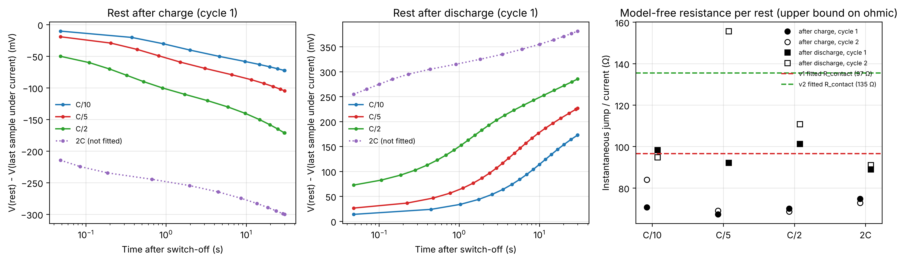
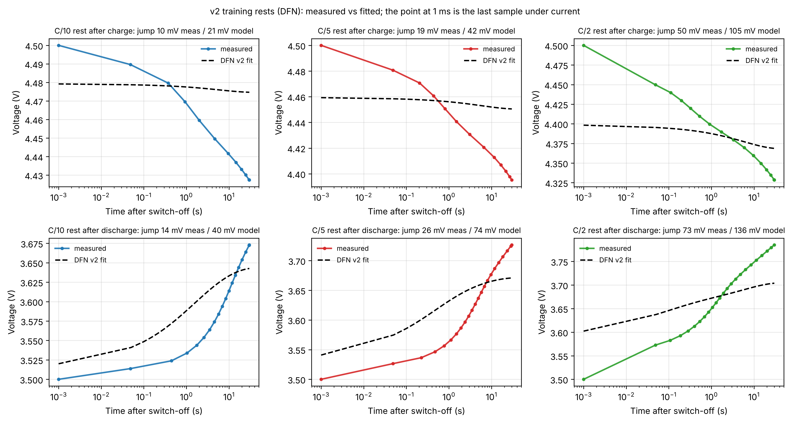
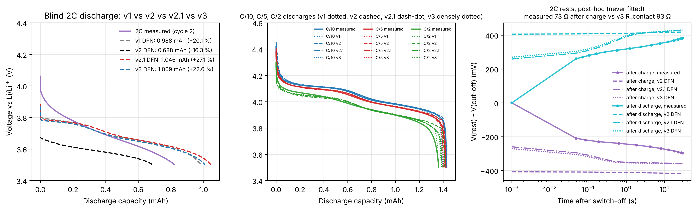
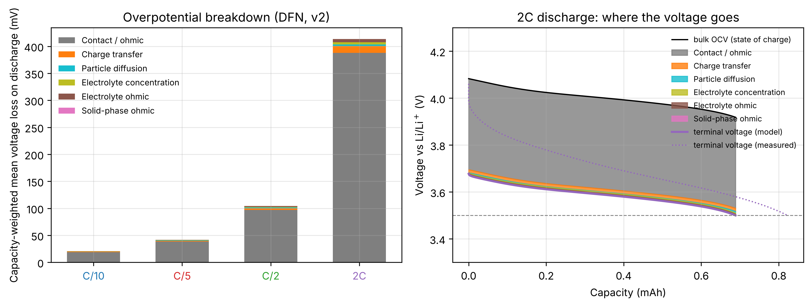
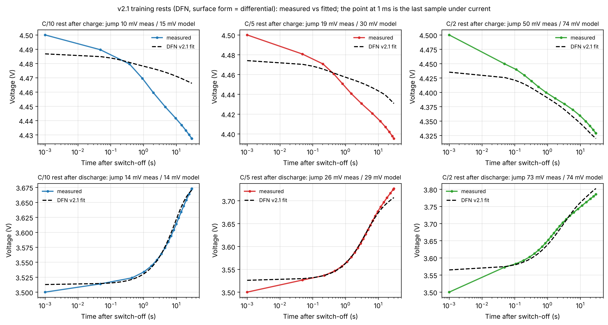
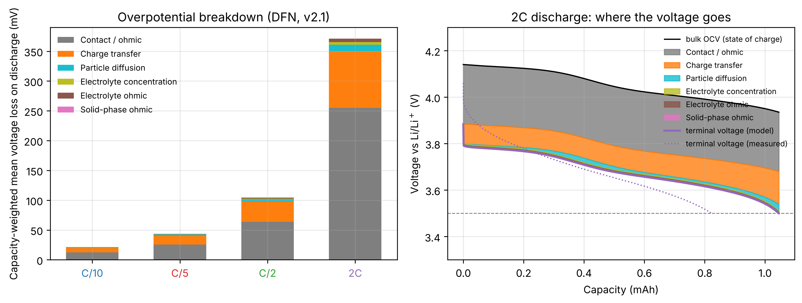
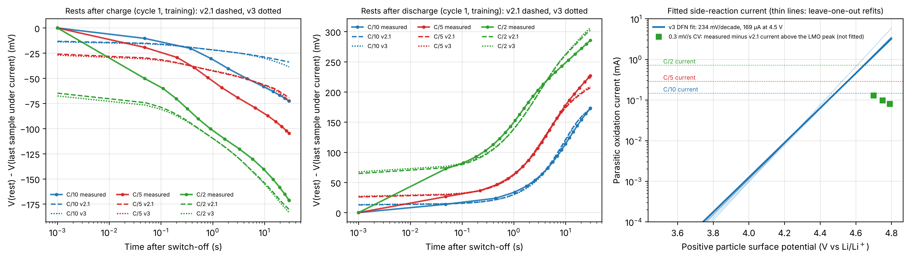
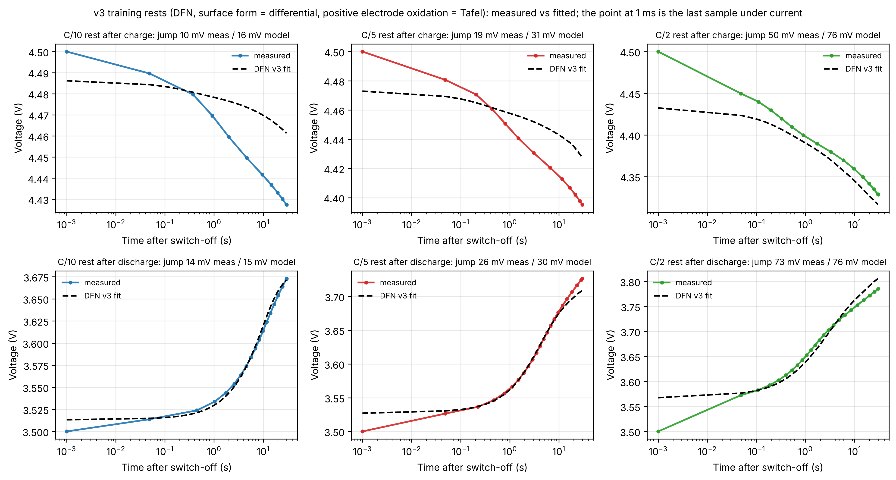

# LiMn2O4 half cell: a physics-based rate model fitted to my own data

A PyBaMM Doyle-Fuller-Newman (DFN) half-cell model of a commercial LiMn2O4 (LMO) cathode against lithium
metal, parameterised with the open-circuit curve I measured at C/10, fitted to my C/5 and C/2 cycles only,
and then asked to predict the 2C cycle it had never seen and the cyclic voltammograms from a different
technique. All data were measured by me on one coin cell (MSE 5550, University of Pennsylvania, 2026;
see `data/README.md`).

## Key results

The headline model is v1 (three parameters fitted to the C/5 and C/2 curves); v2 to v3 below are the later versions, each reported as it came out:

- **Training (C/5, C/2):** voltage RMSE 26 mV with three fitted parameters; C/10, not used in the fit,
  reproduced to 1.0 % in capacity.
- **Blind 2C prediction:** average discharge voltage within 17 mV of measured; discharge capacity
  0.988 mAh against 0.823 mAh measured (+20.1 %). The model predicts a
  30 % capacity loss from C/10 to 2C; the cell lost 42 %. The SPMe gives 0.989 mAh (+20.2 %), so the two model fidelities agree on the 2C result to within 0.2 percentage points.
- **Cyclic voltammetry, a technique never used in the fit:** peak potentials at all three scan rates within
  80 mV (oxidation) and 68 mV (reduction); b-values 0.60 / 0.69 measured vs 0.66 / 0.70 model.
- **Diagnosis:** at 2C the model assigns 74 % of the voltage loss to ohmic/contact resistance; the shape of
  the measured 2C curve says the real cell has a transport loss that grows with time, which the fit could not
  separate from resistance (see "Why 2C loses capacity").
- **v2, rests added to the fit (not an improvement):** refitting on the C/5 and C/2 curves plus the C/10, C/5 and C/2 rests, the 2C capacity error moves from +20.1 % to -16.3 %: a smaller number, but the wrong answer for the wrong reason, because the 135 Ω resistance simply pulls the whole 2C curve down (V-Q RMSE 66 to 149 mV). The model-free rest jumps give 72 Ω (after charge), yet the v2 fit moves R_contact up to 135 Ω: this model has no double-layer capacitance and one particle size, so it cannot reproduce the log-time relaxation the rests show and instead matches their mean level with a bigger ohmic drop (see "v1 vs v2").
- **v2.1, one model change (double layer), same training data as v2:** the rests are now matched to 15 mV with R_contact 89 Ω and k identifiable, but the blind 2C capacity error is +27.1 % against +20.1 % for v1 (2C V-Q RMSE 63 against 66 mV): not an improvement, reported as it came out.
- **v3, one side reaction (electrolyte oxidation), v2.1 data plus the measured excess charge:** the leak the excess charge allows (169 µA at 4.5 V, 234 mV/decade) reproduces the C/10 coulombic efficiency (91 % against 91 % measured) but does not fix the after-charge rests (22 to 21 mV RMSE); blind 2C capacity error +22.6 % against +20.1 % for v1 (2C V-Q RMSE 62 against 66 mV). v3 does not improve the blind 2C prediction, so v1 stays the headline.
The final comparison table of all versions is at the end of the v3 section, and the Conclusions section says what was learned and what experiments would settle the rest.


*Solid: measured. Dashed: DFN. C/5 and C/2 were used for fitting; C/10 is a low-rate check; 2C is a blind prediction.*

## Results

### Galvanostatic cycles (DFN, 10 mm disc)

| Rate | Cycle | Role | Q meas (mAh) | Q model (mAh) | Error (%) | V̄ meas (V) | V̄ model (V) | E meas (mWh) | E model (mWh) | V-Q RMSE (mV) |
|---|---|---|---|---|---|---|---|---|---|---|
| C/10 | 1 | low-rate check | 1.430 | 1.415 | -1.0 | 4.036 | 4.044 | 5.77 | 5.72 | 25 |
| C/5 | 1 | training | 1.422 | 1.401 | -1.5 | 4.016 | 4.023 | 5.71 | 5.64 | 26 |
| C/2 | 1 | training | 1.361 | 1.360 | -0.1 | 3.960 | 3.965 | 5.39 | 5.39 | 21 |
| 2C | 2 | blind prediction | 0.823 | 0.988 | +20.1 | 3.696 | 3.679 | 3.04 | 3.63 | 66 |

V-Q RMSE is computed on the measured capacity axis with the model held at the cut-off voltage beyond its own
capacity, so it penalises a capacity miss as well as a voltage miss. Charge-step metrics are in
`results/validation_dfn.json`; the C/10 and C/5 measured charges are longer than the model's because of
parasitic oxidation near 4.5 V (first-cycle coulombic efficiency at C/10 was 91 %), which the model does not include.

### Fitted effective parameters

| Model | Train RMSE (mV) | τ = R²/Ds (s) | Ds (m²/s) at R = 5 µm | k (m^2.5 mol^-0.5 s^-1) | R_contact (Ω) | 2C prediction (mAh) |
|---|---|---|---|---|---|---|
| SPMe | 26.2 | 2.19e+03 (2.12e+03 to 2.27e+03); LOO 901 to 2.34e+03 | 1.14e-14 (1.1e-14 to 1.18e-14); LOO 1.07e-14 to 2.78e-14 | 2.41e-11 (1.56e-11 to 3.71e-11); LOO 1.19e-11 to 1e-08 | 96.5 (88.2 to 106); LOO 80.6 to 122 | 0.989 (+20.2 %) |
| DFN | 26.2 | 2.19e+03 (2.11e+03 to 2.27e+03); LOO 902 to 2.34e+03 | 1.14e-14 (1.1e-14 to 1.18e-14); LOO 1.07e-14 to 2.77e-14 | 2.41e-11 (1.56e-11 to 3.71e-11); LOO 1.19e-11 to 9.83e-09 | 96.5 (88.2 to 106); LOO 80.5 to 122 | 0.988 (+20.1 %) |

Intervals in brackets are 95 % Jacobian intervals from the least-squares covariance; "LOO" is the range of
refits that each leave one of the four training steps out. The Jacobian intervals are far too narrow because
the 1200 residuals are strongly autocorrelated; the leave-one-out ranges are the more honest
statement of uncertainty. The log-parameters are correlated (k vs R_contact: 0.94), i.e. the data
split the ohmic and the charge-transfer loss only weakly. k enters j0 = k F sqrt(c_e c_s (c_max - c_s)).
Only τ = R²/Ds is identifiable; the 5 µm radius is a fixed choice.

### Cyclic voltammetry, simulated with the measured voltage programme (DFN)

| Scan rate | Ox. peak V (meas / model) | Ox. peak mA (meas / model) | Red. peak V (meas / model) | Red. peak mA (meas / model) | ΔEp mV (meas / model) |
|---|---|---|---|---|---|
| 0.1 mV/s | 4.35 / 4.35 | 1.62 / 1.65 | 3.81 / 3.79 | -1.28 / -1.45 | 548 / 566 |
| 0.2 mV/s | 4.42 / 4.48 | 2.42 / 2.65 | 3.72 / 3.66 | -2.06 / -2.38 | 693 / 813 |
| 0.3 mV/s | 4.49 / 4.57 | 3.12 / 3.42 | 3.64 / 3.57 | -2.73 / -3.12 | 856 / 1004 |

b-value (slope of log peak current vs log scan rate; 0.5 = semi-infinite diffusion, 1.0 = surface/capacitive):
measured 0.60 (oxidation) and 0.69 (reduction); model
0.66 and 0.70. Both sit between the two limits, as expected for a porous
electrode at scan rates where the sweep takes about as long as a 1C discharge. An apparent Randles-Sevcik
diffusivity from the measured peaks (planar-electrode formula, geometric 10 mm disc area, concentration of the
cycling lithium) is 1.8e-13 m²/s, 15.9 times the fitted solid-state Ds of
1.1e-14 m²/s. The two numbers are not expected to agree: Randles-Sevcik assumes a flat electrode, while
the real one is porous with a much larger internal area, so the apparent value is an upper bound.


### Why 2C loses capacity: overpotential breakdown (DFN)

Capacity-weighted mean voltage loss on discharge: C/10 20 mV, C/5 41 mV,
C/2 98 mV, 2C 374 mV. At 2C the model attributes 74 % of the loss to the
lumped contact/ohmic resistance, 17 % to charge transfer, 6 % to solid-state
diffusion in the particles and 3 % to the electrolyte. When the 2C
discharge hits 3.5 V the bulk open-circuit voltage of the particles is still 3.95 V, i.e. the model
has 0.15 mAh of lithium it could not deliver at that rate.


The measured 2C curve falls faster than the model's: the data show a steeper initial decline and lose
12 percentage points more capacity than predicted. The fit on C/5 and C/2 cannot separate a large
ohmic drop from a transport limitation that grows with time, and it picked the ohmic explanation. That is the
single biggest limitation of this work, and it is visible in the k / R_contact correlation above.

### Sensitivity to the unknown electrode area

| Model | Disc (mm) | Loading (mg/cm²) | Coating density (g/cm³) | ε_active | Porosity | Coating | Train RMSE (mV) | R_contact (Ω) | Ds (m²/s) | 2C prediction (mAh) |
|---|---|---|---|---|---|---|---|---|---|---|
| SPMe | 10 | 16.6 | 2.07 | 0.46 | 0.48 | plausible | 26.2 | 97 | 1.14e-14 | 0.989 (+20.2 %) |
| SPMe | 12 | 11.5 | 1.44 | 0.32 | 0.64 | light coating | 26.2 | 99 | 1.14e-14 | 0.989 (+20.2 %) |
| SPMe | 14 | 8.5 | 1.06 | 0.23 | 0.73 | implausibly porous | 26.2 | 101 | 1.14e-14 | 0.989 (+20.2 %) |
| SPMe | 16 | 6.5 | 0.81 | 0.18 | 0.80 | implausibly porous | 26.2 | 102 | 1.14e-14 | 0.989 (+20.2 %) |
| DFN | 10 | 16.6 | 2.07 | 0.46 | 0.48 | plausible | 26.2 | 97 | 1.14e-14 | 0.988 (+20.1 %) |
| DFN | 12 | 11.5 | 1.44 | 0.32 | 0.64 | light coating | 26.2 | 99 | 1.14e-14 | 0.988 (+20.1 %) |
| DFN | 14 | 8.5 | 1.06 | 0.23 | 0.73 | implausibly porous | 26.2 | 101 | 1.14e-14 | 0.989 (+20.2 %) |
| DFN | 16 | 6.5 | 0.81 | 0.18 | 0.80 | implausibly porous | 26.2 | 102 | 1.14e-14 | 0.989 (+20.2 %) |

The disc diameter is genuinely unknown: the EC-Lab `.mpr` settings block has electrode surface area and
characteristic mass at their 0.001 defaults (never entered); only the 1.434 mAh battery capacity was set. The
capacity therefore ties area to active volume fraction. Active mass = 1.434 mAh / 110 mAh/g = 13.0 mg,
active volume = 3.05e-3 cm³ at 4.28 g/cm³, so for the 85 µm coating ε_active = 0.358 / A[cm²]:
10 mm gives 0.46, 12 mm 0.32, 14 mm 0.23 and 16 mm 0.18. Binder and carbon (5.8 wt%) are taken at 1.8 g/cm³ and
the rest of the coating volume is pore. A calendered oxide cathode normally has a porosity of 0.25 to 0.40
(up to ~0.5 uncalendered) and an active volume fraction of 0.45 to 0.65. By that yardstick only the
10 mm disc gives a physically plausible coating; 12 mm would be an
unusually light coating and 14 to 16 mm imply porosities of 0.73 to 0.80, which no real electrode has. Either
the disc is small, or the 1.434 mAh (110 mAh/g) capacity under-states the active loading, so that the true
ε_active is higher than this derivation gives for any disc. The three parameters were re-fitted for every
diameter: the training RMSE, τ, k and the 2C prediction do not change to the precision shown
(2C spans 0.988 to 0.989 mAh), and only R_contact drifts by a few ohms as the electrolyte and solid
ohmic paths take up slack. The model is not electrolyte-limited with a lithium-metal counter electrode and this
electrolyte, so the unknown area does not affect the headline result. The headline uses the 10 mm disc, the only
diameter that gives a physically plausible coating.


## v1 vs v2: adding the post-step rests to the fit

v1 fitted only the C/5 and C/2 charge/discharge curves, which cannot separate an instantaneous ohmic drop from a
transport loss that builds over time (k vs R_contact correlation 0.94); it fitted
R_contact = 96.5 Ω and over-predicted the blind 2C capacity by +20.1 %. Every galvanostatic
step ends with a 30 s rest whose first sample is logged 48 ms after the current switches off. v2 keeps the
same model, the same three parameters and the same 10 mm disc, and adds those rests to the training residual. No 2C
data (curves or rests) is used in either version.

### Model-free check: instantaneous resistance of every rest

Jump = first rest sample minus last sample under current, straight from the raw files. The first sample already
contains whatever charge-transfer overpotential relaxed in the first 48 ms, so jump / I is an upper bound
on the pure ohmic resistance.

| Rate | Cycle | After | I (mA) | First sample (ms) | Jump (mV) | Jump / I (Ω) | 30 s relaxation (mV) | Use |
|---|---|---|---|---|---|---|---|---|
| C/10 | 1 | charge | 0.147 | 48 | 10.4 | 71 | 73 | fitted (v2) |
| C/10 | 1 | discharge | 0.140 | 48 | 13.8 | 98 | 173 | fitted (v2) |
| C/10 | 2 | charge | 0.147 | 48 | 12.3 | 84 | 70 | not fitted |
| C/10 | 2 | discharge | 0.140 | 48 | 13.3 | 95 | 174 | not fitted |
| C/5 | 1 | charge | 0.287 | 48 | 19.3 | 67 | 105 | fitted (v2) |
| C/5 | 1 | discharge | 0.286 | 48 | 26.4 | 92 | 227 | fitted (v2) |
| C/5 | 2 | charge | 0.287 | 48 | 19.8 | 69 | 105 | not fitted |
| C/5 | 2 | discharge | 0.286 | 48 | 44.6 | 156 | 232 | not fitted |
| C/2 | 1 | charge | 0.717 | 48 | 50.2 | 70 | 171 | fitted (v2) |
| C/2 | 1 | discharge | 0.717 | 48 | 72.6 | 101 | 285 | fitted (v2) |
| C/2 | 2 | charge | 0.717 | 48 | 49.2 | 69 | 172 | not fitted |
| C/2 | 2 | discharge | 0.717 | 48 | 79.4 | 111 | 287 | not fitted |
| 2C | 1 | charge | 2.871 | 48 | 214.6 | 75 | 300 | post-hoc only, never fitted |
| 2C | 1 | discharge | 2.864 | 48 | 254.8 | 89 | 381 | post-hoc only, never fitted |
| 2C | 2 | charge | 2.871 | 48 | 209.1 | 73 | 296 | post-hoc only, never fitted |
| 2C | 2 | discharge | 2.864 | 48 | 260.6 | 91 | 382 | post-hoc only, never fitted |

After charge the jump gives 72 Ω on average over C/10, C/5 and C/2 (2C, post-hoc: 74 Ω), well
below the v1 contact resistance of 97 Ω: v1 assigned too much of the loss to resistance. After discharge the jump is
larger (109 Ω on average) because the cut-off at 3.5 V sits on the steep end of the OCV where the exchange current
is smallest and the particle surface relaxes fastest. The C/5 cycle-2 discharge rest (156 Ω) carries the 22 mV contact
disturbance noted in `data/README.md`, which returns at the switch-off and so is confirmed as a contact resistance. What
the table does not show, and the figure does, is the shape: the relaxation after the jump is close to linear in
log(time) from 50 ms to 30 s, i.e. a distributed process, not one exponential or one sqrt(t) diffusion tail.



### v2 fit

Training residual: the v1 curve residual (C/5 and C/2 cycle 1, charge and discharge, 300 points each, 1200
points) plus the model minus measured voltage at every logged point of the six cycle-1 rests after the C/10, C/5 and
C/2 steps (101 points), time measured from the last sample under current. Each rest residual is
multiplied by w = sqrt(λ · N_curve / N_rest) so that the rest block carries λ times the summed squared weight of the
curve block; the headline uses λ = 1 (w = 3.4 per rest point), and the table below shows λ = 0.25, 1, 4, the
unweighted case, and a variant in which only the first sample of each rest (the instantaneous jump) enters. The rests
are output at 0.05 s in the model with a particle mesh refined at the surface (60 radial points, exponential stretch),
because the uniform v1 mesh lags the surface relaxation by seconds. The C/10 curves remain a check, but its rests are
now training data. Leave-one-out refits drop one of the 10 residual blocks (4 curve steps, 6 rests) in turn.

| Fit | Train RMSE curves / rests (mV) | τ = R²/Ds (s) | k (m^2.5 mol^-0.5 s^-1) | R_contact (Ω) | k–R_contact corr. | 2C prediction (mAh) |
|---|---|---|---|---|---|---|
| v1 DFN | 26.2 / – | 2.19e+03 (2.11e+03 to 2.27e+03); LOO 902 to 2.34e+03 | 2.41e-11 (1.56e-11 to 3.71e-11); LOO 1.19e-11 to 9.83e-09 | 96.5 (88.2 to 106); LOO 80.5 to 122 | 0.94 | 0.988 (+20.1 %) |
| v2 DFN (full rest traces, λ = 1) | 28.8 / 40.2 | 207 (179 to 240); LOO 156 to 420 | 9.99e-09 (at bound, Jacobian interval undefined); LOO 1e-08 to 1e-08 | 135 (130 to 141); LOO 130 to 141 | 0.62 | 0.688 (-16.3 %) |
| v2 DFN (jump only, λ = 1) | 33.0 / 87.4 | 2.5 (0.0218 to 286) | 1e-08 (at bound, Jacobian interval undefined) | 113 (109 to 117) | 0.54 | 1.212 (+47.3 %) |

Intervals as in the v1 table (95 % Jacobian; LOO = leave-one-block-out range). k enters j0 = k F sqrt(c_e c_s (c_max - c_s)); its
bounds are 1e-14 to 1e-8 and Ds's are 1e-17 to 1e-11 m²/s. In the headline v2 fit k sits at the bound of the search box, i.e. the optimiser wants no loss from that term at all.
The k–R_contact correlation drops from 0.94 to 0.62, so the rests do decorrelate the two parameters, but not in the
direction expected: R_contact moves up to 135 Ω although the rests themselves say 72 Ω.



| Rest | I (mA) | Jump, mV (meas / v2 / v2 jump-only) | Jump / I, Ω (meas / v2 / v2 jump-only) | 30 s relaxation, mV (meas / v2 / v2 jump-only) |
|---|---|---|---|---|
| C/10 rest after charge | 0.147 | 10 / 21 / 18 | 71 / 145 / 120 | 73 / 25 / 18 |
| C/10 rest after discharge | 0.140 | 14 / 40 / 19 | 98 / 287 / 134 | 173 / 143 / 20 |
| C/5 rest after charge | 0.287 | 19 / 42 / 34 | 67 / 145 / 120 | 105 / 50 / 35 |
| C/5 rest after discharge | 0.286 | 26 / 74 / 38 | 92 / 257 / 132 | 227 / 171 / 41 |
| C/2 rest after charge | 0.717 | 50 / 105 / 86 | 70 / 146 / 120 | 171 / 131 / 87 |
| C/2 rest after discharge | 0.717 | 73 / 136 / 91 | 101 / 190 / 127 | 285 / 204 / 96 |

**Why the model cannot use the rests.** The measured relaxation keeps going at roughly the same number of mV per
decade of time from 50 ms to 30 s. In this model the current switches off and three things happen: the contact,
electrolyte and solid ohmic drops vanish at once, the charge-transfer overpotential vanishes at once (there is no
double-layer capacitance), and the particle-surface concentration relaxes as sqrt(t) with one time constant R²/Ds.
Nothing relaxes like log(t). Forced to put a 100 to 280 mV relaxation somewhere, the least-squares fit can only
match its mean level, which it does by making the instantaneous jump larger (bigger R_contact, k at the bound so that
charge transfer costs nothing) and the diffusion faster. The curves and the rests are therefore inconsistent inside
this model structure: the curves need about 97 Ω of resistance plus a charge-transfer overpotential, the rests say only
72 Ω of all that is instantaneous, and the remainder relaxes over seconds in a way that is neither Butler-Volmer-instantaneous nor
single-particle Fickian. That is the finding of v2.

### Sensitivity to the rest weighting

| Model | Rest weighting | w per rest point | Rest points | τ (s) | k | R_contact (Ω) | k–R corr. | Curves RMSE (mV) | Rest traces RMSE (mV) |
|---|---|---|---|---|---|---|---|---|---|
| SPMe | unweighted | 1.0 | 101 | 467 | 6.4e-11 | 125 | 0.88 | 27.7 | 45.8 |
| SPMe | lambda=0.25 | 1.7 | 101 | 233 | 1e-08 | 135 | 0.80 | 28.7 | 40.3 |
| SPMe | lambda=1 | 3.4 | 101 | 207 | 9.99e-09 | 135 | 0.63 | 28.8 | 40.2 |
| SPMe | lambda=4 | 6.9 | 101 | 200 | 1e-08 | 135 | 0.48 | 28.8 | 40.2 |
| SPMe | jump only, lambda=1 | 14.1 | 6 | 2.5 | 1e-08 | 113 | 0.58 | 33.0 | 87.4 |

Every weighting that uses the full rest traces moves R_contact above the v1 value; the jump-only variant, which
asks the model to match only the first sample of each rest, cannot do that either without losing the curves (its curve
RMSE is the worst), because the model's instantaneous jump is R_contact plus the whole charge-transfer overpotential,
and the curves need more current-proportional loss than 72 Ω provides.


### Blind validation, v1 vs v2 (DFN)

| Rate | Role | Q meas (mAh) | Q v1 | Q v2 | V̄ meas (V) | V̄ v1 | V̄ v2 | E meas (mWh) | E v1 | E v2 | V-Q RMSE v1 (mV) | V-Q RMSE v2 (mV) |
|---|---|---|---|---|---|---|---|---|---|---|---|---|
| C/10 | curve not fitted; its rests are in v2 | 1.430 | 1.415 (-1.0 %) | 1.425 (-0.3 %) | 4.036 | 4.044 | 4.044 | 5.77 | 5.72 | 5.76 | 25 | 15 |
| C/5 | training | 1.422 | 1.401 (-1.5 %) | 1.422 (-0.0 %) | 4.016 | 4.023 | 4.022 | 5.71 | 5.64 | 5.72 | 26 | 15 |
| C/2 | training | 1.361 | 1.360 (-0.1 %) | 1.412 (+3.7 %) | 3.960 | 3.965 | 3.958 | 5.39 | 5.39 | 5.59 | 21 | 40 |
| 2C | blind prediction | 0.823 | 0.988 (+20.1 %) | 0.688 (-16.3 %) | 3.696 | 3.679 | 3.588 | 3.04 | 3.63 | 2.47 | 66 | 149 |

The 2C capacity error moves from +20.1 % to -16.3 %: a smaller number, but the wrong answer for the wrong reason, because the 135 Ω resistance simply pulls the whole 2C curve down (V-Q RMSE 66 to 149 mV). In numbers: 2C V-Q RMSE 66 mV (v1) against 149 mV (v2), mean-voltage error
-17 against -108 mV, energy error +19.5 % against -18.8 %. The jump-only variant, with no diffusion and no charge-transfer loss left, predicts 1.212 mAh (+47.3 %). Nothing was tuned on 2C or on the CVs; the v2 fits are reported as they came out.



Cyclic voltammetry with the v2 parameters, simulated with the measured voltage programme as in v1:

| Scan rate | Ox. peak V (meas / v2) | Ox. peak mA (meas / v2) | Red. peak V (meas / v2) | Red. peak mA (meas / v2) | ΔEp mV (meas / v2) |
|---|---|---|---|---|---|
| 0.1 mV/s | 4.35 / 4.39 | 1.62 / 1.60 | 3.81 / 3.74 | -1.28 / -1.50 | 548 / 644 |
| 0.2 mV/s | 4.42 / 4.50 | 2.42 / 2.49 | 3.72 / 3.59 | -2.06 / -2.47 | 693 / 906 |
| 0.3 mV/s | 4.49 / 4.65 | 3.12 / 3.34 | 3.64 / 3.48 | -2.73 / -3.24 | 856 / 1170 |

b-values with v2: 0.66 (oxidation) and 0.70 (reduction) against 0.60 / 0.69 measured
(v1: 0.66 / 0.70). The largest CV peak shift is 159 mV with v2 against 80 mV with v1.

### Overpotential breakdown at 2C with v2

Capacity-weighted mean loss on the 2C discharge: 414 mV (v1: 374 mV), of which 94 % contact/ohmic
(v1 74 %), 3 % charge transfer (v1 17 %), 1 % particle diffusion
(v1 6 %) and 2 % electrolyte. The bulk OCV at the 2C cut-off is 3.92 V, i.e. 0.07 mAh locked out
(v1: 3.95 V, 0.15 mAh).



### Post-hoc: the 2C rests (never used for fitting)

Measured 2C cycle-2 jumps: 73 Ω after charge and 91 Ω after discharge, against the v2 R_contact of 135 Ω; the v2 model jumps are 142 and 142 Ω, and its 30 s relaxations 417 / 418 mV against 296 / 382 mV measured.
The 2C after-charge jump sits with the C/10 to C/2 ones at about 70 to 75 Ω, so the instantaneous resistance of the
cell is rate-independent and the v2 value is not it: the comparison confirms the diagnosis above rather than the fit.

### v2.1: giving the model a relaxation (same data, one model change)

v2 established that the v1 model class cannot hold the rests. v2.1 changes the model, not the data: it is fitted to
exactly the same curves and rests as v2 (λ = 1, full rest traces), 2C stays blind, and the change is chosen on the
training data alone. Two standard PyBaMM options add the missing physics, each with one new fitted parameter:

- **Double-layer capacitance** (`surface form: differential`): the charge-transfer overpotential relaxes through
  R_ct·C_dl instead of vanishing at the switch-off. In the intermittent-current-interruption literature this RC
  process is what sets the voltage between about 2 ms and 1 s after an interruption, with the ohmic drop before
  it and the √t diffusion tail after it (Geng, Thiringer and Lacey, IEEE Trans. Transp. Electrif. 2021). The
  fitted C_dl is an effective value per unit of model particle surface, so it also absorbs the unknown real
  surface area.
- **Particle-size distribution** (`particle size: distribution`, the MP-DFN / MPM): an area-weighted lognormal
  radius distribution with the v1 mean of 5 µm and a fitted relative standard deviation sd_p spreads the
  diffusion time constant R²/Ds over sizes. Kirk, Please and Chapman (J. Electrochem. Soc. 168, 2021) showed
  that this, and not any single-size DFN, reproduces the slow voltage relaxation after a discharge.

Both options also exist together. All three variants were fitted with the SPMe (each from 3 starting points, lowest
cost kept, because the cost surface has several minima); the DFN then runs the chosen variant from the SPMe optimum.
The table is training data only and decided which variant goes forward:

| Model | Variant | PyBaMM options | τ (s) | k | R_contact (Ω) | Extra parameter(s) | k–R corr. | Curves RMSE (mV) | Rests RMSE (mV) |
|---|---|---|---|---|---|---|---|---|---|
| SPMe | dl (headline) | surface form: differential | 1e+03 | 1.13e-11 | 89 | C_dl = 3.15 | 0.88 | 26.0 | 14.9 |
| SPMe | psd | particle size: distribution | 134 | 1.48e-11 | 84 | sd_p = 2 | 0.90 | 23.6 | 35.7 |
| SPMe | psd+dl | surface form: differential, particle size: distribution | 773 | 1.66e-11 | 88 | C_dl = 3.03, sd_p = 0.554 | 0.87 | 23.2 | 15.3 |
| DFN | dl (headline) | surface form: differential | 997 | 1.13e-11 | 89 | C_dl = 3.15 | 0.88 | 26.0 | 14.9 |

The headline v2.1 variant is **dl** (`surface form: differential`), chosen because it gives the lowest rest misfit for the fewest
added parameters without worsening the curves. Its parameters with 95 % Jacobian and leave-one-block-out intervals:

| Fit | Train RMSE curves / rests (mV) | τ = R²/Ds (s) | k | R_contact (Ω) | k–R_contact corr. | 2C prediction (mAh) |
|---|---|---|---|---|---|---|
| v1 DFN | 26.2 / – | 2.19e+03 (2.11e+03 to 2.27e+03); LOO 902 to 2.34e+03 | 2.41e-11 (1.56e-11 to 3.71e-11); LOO 1.19e-11 to 9.83e-09 | 96.5 (88.2 to 106); LOO 80.5 to 122 | 0.94 | 0.988 (+20.1 %) |
| v2 DFN | 28.8 / 40.2 | 207 (179 to 240); LOO 156 to 420 | 9.99e-09 (at bound, Jacobian interval undefined); LOO 1e-08 to 1e-08 | 135 (130 to 141); LOO 130 to 141 | 0.62 | 0.688 (-16.3 %) |
| v2.1 DFN (dl) | 26.0 / 14.9 | 997 (909 to 1.09e+03); LOO 805 to 1.2e+03 | 1.13e-11 (9.49e-12 to 1.35e-11); LOO 8.01e-12 to 3.01e-11 | 89 (83.5 to 95); LOO 74.1 to 104 | 0.88 | 1.046 (+27.1 %) |

Extra parameter(s): C_dl = 3.15 (2.92 to 3.4); LOO 2.76 to 3.51 F/m2 of particle surface (effective; absorbs the unknown real surface area).



| Rest | I (mA) | Jump at 48 ms, mV (meas / v2.1) | Jump / I, Ω (meas / v2.1) | 30 s relaxation, mV (meas / v2.1) | Error at 30 s (mV) |
|---|---|---|---|---|---|
| C/10 rest after charge | 0.147 | 10 / 15 | 71 / 103 | 73 / 34 | +39 |
| C/10 rest after discharge | 0.140 | 14 / 14 | 98 / 102 | 173 / 170 | -3 |
| C/5 rest after charge | 0.287 | 19 / 30 | 67 / 103 | 105 / 69 | +35 |
| C/5 rest after discharge | 0.286 | 26 / 29 | 92 / 103 | 227 / 207 | -20 |
| C/2 rest after charge | 0.717 | 50 / 74 | 70 / 103 | 171 / 180 | -9 |
| C/2 rest after discharge | 0.717 | 73 / 74 | 101 / 103 | 285 / 302 | +17 |

With a double layer the charge-transfer overpotential no longer has to vanish at the switch-off, so the rests are
matched to 15 mV against 40 mV in v2 with the curves at 26.0 mV, k is identifiable again and sits
near its v1 value, and R_contact comes out at 89 Ω. That is above the 72 Ω model-free jump: the model over-shoots the 48 ms sample (one point in 10 to 25 per rest) and uses the RC relaxation to match the rest of the trace, so the first sample is still not reproduced and the ohmic part of the loss is still not pinned. The other minima the SPMe
multi-start found (R_contact 101 Ω at cost 1.15, R_contact 89 Ω at cost 1.08, R_contact 101 Ω at cost 1.15) are listed in
`results/v2_1_fit_spme.json`. What the variant still misses is in the figure: the slow tail of the rests after charge at C/10 and C/5 (tens of mV
between 1 and 30 s), the regime Kirk et al. attribute to a size distribution.

#### Blind validation, v1 vs v2 vs v2.1 (DFN)

| Rate | Role | Q meas (mAh) | Q v1 | Q v2 | Q v2.1 | V-Q RMSE v1 (mV) | v2 | v2.1 | V̄ error v1 (mV) | v2 | v2.1 |
|---|---|---|---|---|---|---|---|---|---|---|---|
| C/10 | curve not fitted; rests in v2 and v2.1 | 1.430 | 1.415 (-1.0 %) | 1.425 (-0.3 %) | 1.423 (-0.4 %) | 25 | 15 | 16 | +8 | +8 | +7 |
| C/5 | training | 1.422 | 1.401 (-1.5 %) | 1.422 (-0.0 %) | 1.415 (-0.5 %) | 26 | 15 | 11 | +7 | +6 | +5 |
| C/2 | training | 1.361 | 1.360 (-0.1 %) | 1.412 (+3.7 %) | 1.391 (+2.2 %) | 21 | 40 | 32 | +5 | -1 | -1 |
| 2C | blind prediction | 0.823 | 0.988 (+20.1 %) | 0.688 (-16.3 %) | 1.046 (+27.1 %) | 66 | 149 | 63 | -17 | -108 | -19 |

v2.1 does not improve the blind 2C capacity: the blind 2C capacity error is +20.1 % (v1), -16.3 % (v2) and +27.1 % (v2.1); the 2C V-Q RMSE 66, 149 and 63 mV. At 2C the double layer is charged within a second and then plays no part, so v2.1 behaves like v1 with a lower resistance, a larger charge-transfer share and faster diffusion (τ = 997 s against 2192 s), which is why its capacity comes out higher still. CVs with v2.1: largest peak shift 105 mV (v1 80, v2 159); b-values 0.69 / 0.74 against 0.60 / 0.69 measured.


At 2C the v2.1 model attributes 69 % of the mean loss to contact/ohmic resistance, 26 % to charge transfer and 3 % to particle diffusion (v1: 74 / 17 / 6 %), with 0.10 mAh locked in the particles at the cut-off.
Post-hoc 2C rests (never fitted): measured jumps 73 / 91 Ω after charge / discharge, v2.1 model 103 / 102 Ω; 30 s relaxation 296 / 382 mV measured against 358 / 428 mV; rest RMSE 85 / 55 mV.



## v3: one parasitic oxidation reaction at the positive electrode

v2.1 left two things open: the first 48 ms that no sample resolves, and the slow tail of the rests that start at the
4.5 V charge cut-off (the rests that start at 3.5 V are matched). The second has a candidate already in this data: the
cell loses charge to a side reaction near 4.5 V (first-cycle coulombic efficiency 91 % at C/10, measured charge
capacities longer than discharge capacities at every rate), and a parasitic current that keeps flowing at open circuit
would be balanced by lithium re-intercalation, i.e. self-discharge, which pulls the voltage down. Electrolyte oxidation on
charged LiMn2O4 is the textbook source of such a current: carbonate electrolytes oxidise on the delithiated spinel
above about 4.3 V, and the self-discharge of Li/LixMn2O4 cells at the 4 V plateaus proceeds by lithium re-intercalation
from the electrolyte. v3 adds exactly one such reaction to the v2.1 model and asks whether it explains the after-charge
rests.

**Model.** One anodic Tafel reaction on the LMO particle surface, in parallel with the intercalation reaction:
j_ox = j_ref · exp(α_ox F (φ_s − φ_e − 4.5 V) / RT), with two fitted parameters, j_ref (the parasitic current density at
4.5 V) and α_ox (the Tafel slope is 59 mV / α_ox per decade); a free onset potential would be degenerate with j_ref. The
reaction consumes nothing the model tracks, so its only effects are that part of the charging current never enters the
particles and that at open circuit the oxidation is balanced by re-intercalation. In PyBaMM the second interfacial
reaction is carried by the SEI machinery, which since PyBaMM 23.9 runs on the positive electrode through a 2-tuple `SEI`
option; because all of PyBaMM's built-in SEI kinetics are cathodic, `src/lmo/oxidation.py` subclasses `SEIGrowth` and
replaces its rate with the anodic law above (the lithium-metal counter electrode gets no side reaction, and the SEI
"concentration" state is kept only as a counter of the parasitic charge). Everything else is v2.1: double layer, same
disc, same mesh.

**Training data.** Exactly the v2.1 data (C/5 and C/2 cycle-1 curves, the six C/10, C/5 and C/2 cycle-1 rests at λ = 1)
plus two constraint residuals: the model's charge-minus-discharge capacity of C/10 cycle 1 and of C/5 cycle 1 against
the measured excess charge (137 and 33 µAh), weighted so that the two together carry the curve block's weight when
each misses by 30 % (the C/10 run read its current on a coarse range, ±2.5 %, which alone is ±40 µAh on its excess). 2C is
never used. The SPMe was fitted from 3 starting points (the v2.1 optimum with a strong leak at a conventional Tafel slope, a weak
leak, and a nearly potential-independent leak: cost 1.068 from j_ref 2e-02, α 0.5 (→ 172 µA, α 0.26), cost 1.052 from j_ref 3e-03, α 0.1 (→ 169 µA, α 0.25), cost 1.895 from j_ref 1e-02, α 0.03 (→ 20 µA, α 0.088)), the lowest cost kept; the DFN runs once from the SPMe optimum. Leave-one-out drops one of the 12 residual blocks
(4 curve steps, 6 rests, 2 excess-charge constraints) in turn.

### v3 fit

| Fit | Train RMSE curves / rests after charge / after discharge (mV) | τ = R²/Ds (s) | k | R_contact (Ω) | C_dl (F/m²) | k–R_contact corr. | 2C prediction (mAh) |
|---|---|---|---|---|---|---|---|
| v2.1 DFN | 26.0 / 21.8 / 8.2 | 997 (909 to 1.09e+03); LOO 805 to 1.2e+03 | 1.13e-11 (9.49e-12 to 1.35e-11); LOO 8.01e-12 to 3.01e-11 | 89 (83.5 to 95); LOO 74.1 to 104 | 3.15 (2.92 to 3.4); LOO 2.76 to 3.51 | 0.88 | 1.046 (+27.1 %) |
| v3 DFN | 25.8 / 21.0 / 8.3 | 1.13e+03 (1.03e+03 to 1.23e+03); LOO 686 to 2.15e+03 | 1.35e-11 (1.12e-11 to 1.63e-11); LOO 7.21e-12 to 4.52e-11 | 92.9 (87.7 to 98.4); LOO 70.6 to 107 | 3.37 (3.14 to 3.61); LOO 2.61 to 4.41 | 0.86 | 1.009 (+22.6 %) |

Side reaction: j_ref = 0.0924 (0.0916 to 0.0932); LOO 0.0899 to 0.122 A/m² of particle surface at 4.5 V, i.e. 169 µA per cell (leave-one-out 164 to 223 µA); alpha_ox = 0.253 (0.25 to 0.255); LOO 0.249 to 0.28, i.e. a Tafel slope of 234 mV per decade (leave-one-out 212 to 237 mV). The fit chose a Tafel slope of 234 mV per decade (1 µA at 4.0 V, 24 µA at 4.3 V, 169 µA at 4.5 V); that is 169 µA at 4.5 V, 115 % of the C/10 charging current and 24 % of the C/2 one.



| Rest | I (mA) | Jump at 48 ms, mV (meas / v2.1 / v3) | 30 s relaxation, mV (meas / v2.1 / v3) | Error at 30 s, mV (v2.1 / v3) | Rest RMSE, mV (v2.1 / v3) |
|---|---|---|---|---|---|
| C/10 rest after charge | 0.147 | 10 / 15 / 16 | 73 / 34 / 39 | +39 / +34 | 27.8 / 25.4 |
| C/5 rest after charge | 0.287 | 19 / 30 / 31 | 105 / 69 / 73 | +35 / +32 | 24.1 / 23.2 |
| C/2 rest after charge | 0.717 | 50 / 74 / 76 | 171 / 180 / 184 | -9 / -12 | 13.0 / 14.5 |
| C/10 rest after discharge | 0.140 | 14 / 14 / 15 | 173 / 170 / 171 | -3 / -2 | 4.5 / 3.9 |
| C/5 rest after discharge | 0.286 | 26 / 29 / 30 | 227 / 207 / 209 | -20 / -18 | 7.7 / 6.8 |
| C/2 rest after discharge | 0.717 | 73 / 74 / 76 | 285 / 302 / 306 | +17 / +21 | 10.7 / 11.5 |

**Rests:** the after-charge rest misfit does not improve (21.8 mV RMSE in v2.1, 21.0 mV in v3; after discharge 8.2 to 8.3 mV). The reason is arithmetic, not the optimiser. To pass the measured excess the leak has to be as large as the C/10 charging current at the cut-off (169 µA against 147 µA), so at the end of the C/10 charge almost all of the applied current goes into the side reaction and the intercalation current, with its overpotential, has already fallen towards zero before the current is switched off; at open circuit the same leak is then supplied by re-intercalation. Whatever the leak takes from the applied current before the switch-off it takes back after it, so the voltage swing between the last sample under current and the rest is still set by the overpotential of the applied current, with or without the leak: the model's 30 s relaxation after the C/10 charge moves from 34 mV (v2.1) to 39 mV (v3) against 73 mV measured. A side reaction redistributes the relaxation; it does not enlarge it. The side reaction therefore explains the coulombic efficiency and the longer measured charges, not the after-charge rests.

**Coulombic efficiency:** the model reproduces a first-cycle coulombic efficiency of 91.0 % at C/10 against 91.2 % measured and 97.7 % at C/5 against 97.7 %. Both cycles of every low-rate run, with the model's own charge and discharge capacities:

| Run | Role in v3 | Charge, mAh (meas / v3) | Discharge, mAh (meas / v3) | Excess, µAh (meas / v3) | Coulombic efficiency, % (meas / v3) |
|---|---|---|---|---|---|
| C/10 cycle 1 | training (excess-charge constraint) | 1.567 / 1.529 | 1.430 / 1.392 | 137 / 137 | 91.2 / 91.0 |
| C/10 cycle 2 | check | 1.505 / 1.536 | 1.422 / 1.392 | 83 / 144 | 94.5 / 90.6 |
| C/5 cycle 1 | training (excess-charge constraint) | 1.455 / 1.435 | 1.422 / 1.402 | 33 / 33 | 97.7 / 97.7 |
| C/5 cycle 2 | check | 1.433 / 1.441 | 1.417 / 1.401 | 16 / 39 | 98.9 / 97.3 |
| C/2 cycle 1 | check | 1.390 / 1.392 | 1.361 / 1.385 | 28 / 7 | 98.0 / 99.5 |
| C/2 cycle 2 | check | 1.367 / 1.399 | 1.358 / 1.385 | 9 / 14 | 99.4 / 99.0 |

The measured excess falls from cycle 1 to cycle 2 at every rate and is not proportional to the time spent at high voltage
(C/2 cycle 1 loses almost as much as C/5 cycle 1 in less than half the time), which a steady potential-dependent leak
cannot reproduce: the fit lands between the C/10 and C/5 values. Part of the first-cycle excess is therefore a one-off
(surface-film formation on the fresh electrode, and the C/10 current-range offset), not a steady leak.

The 0.3 mV/s sweep to 4.8 V, outside the galvanostatic window and never fitted, is a model-free check of the leak: above the LMO oxidation peak the measured current exceeds the intercalation-only v2.1 model by 129 µA at 4.70 V and 80 µA at 4.79 V, an upper bound on the parasitic current there, and the v3 model gives 1.12 mA at 4.79 V against 0.30 mA measured (v2.1: 0.22 mA). The simulated leak there is 11 times the upper bound the CV allows (the particle surface sits about 130 mV below the terminal voltage at that current): a steady potential-driven oxidation with this slope is contradicted by the CV, and the excess charge at C/10 must come mostly from something that does not grow with potential and fades with cycling (surface-film formation on the fresh electrode, plus the C/10 current-range offset).

### Blind validation, all versions (DFN)

| Rate | Role | Q meas (mAh) | Q v1 | Q v2 | Q v2.1 | Q v3 | V-Q RMSE v1 (mV) | v2 | v2.1 | v3 | V̄ error v1 (mV) | v2 | v2.1 | v3 |
|---|---|---|---|---|---|---|---|---|---|---|---|---|---|---|
| C/10 | curve not fitted; rests in v2 to v3, excess charge in v3 | 1.430 | 1.415 (-1.0 %) | 1.425 (-0.3 %) | 1.423 (-0.4 %) | 1.392 (-2.6 %) | 25 | 15 | 16 | 52 | +8 | +8 | +7 | +5 |
| C/5 | training | 1.422 | 1.401 (-1.5 %) | 1.422 (-0.0 %) | 1.415 (-0.5 %) | 1.402 (-1.4 %) | 26 | 15 | 11 | 27 | +7 | +6 | +5 | +5 |
| C/2 | training | 1.361 | 1.360 (-0.1 %) | 1.412 (+3.7 %) | 1.391 (+2.2 %) | 1.385 (+1.7 %) | 21 | 40 | 32 | 32 | +5 | -1 | -1 | +0 |
| 2C | blind prediction | 0.823 | 0.988 (+20.1 %) | 0.688 (-16.3 %) | 1.046 (+27.1 %) | 1.009 (+22.6 %) | 66 | 149 | 63 | 62 | -17 | -108 | -19 | -25 |

The blind 2C capacity error is +20.1 % (v1), -16.3 % (v2), +27.1 % (v2.1) and +22.6 % (v3), with 2C V-Q RMSE 66, 149, 63 and 62 mV. v3 does not improve the blind 2C prediction, so v1 stays the headline. The C/10 curve, a check in every version, is worse in v3 (capacity -2.6 % and V-Q RMSE 52 mV against -1.0 % and 25 mV for v1), because the leak ends the C/10 charge with less lithium extracted and the next discharge is shorter. At 2C the v3 model attributes 71 % of the mean loss to contact/ohmic resistance, 23 % to charge transfer and 3 % to particle diffusion (v2.1: 69 / 26 / 3 %). Post-hoc 2C rests (never fitted): measured jumps 73 / 91 Ω after charge / discharge, v3 model 106 / 106 Ω; rest RMSE 89 / 59 mV.


Cyclic voltammetry with the v3 parameters (never fitted):

| Scan rate | Ox. peak V (meas / v3) | Ox. peak mA (meas / v3) | Red. peak V (meas / v3) | Red. peak mA (meas / v3) | ΔEp mV (meas / v3) |
|---|---|---|---|---|---|
| 0.1 mV/s | 4.35 / 4.37 | 1.62 / 1.67 | 3.81 / 3.78 | -1.28 / -1.43 | 548 / 590 |
| 0.2 mV/s | 4.42 / 4.50 | 2.42 / 2.71 | 3.72 / 3.65 | -2.06 / -2.40 | 693 / 848 |
| 0.3 mV/s | 4.49 / 4.60 | 3.12 / 3.54 | 3.64 / 3.55 | -2.73 / -3.18 | 856 / 1050 |

Largest peak shift 105 mV (v1 80, v2.1 105); b-values 0.68 / 0.73 against 0.60 / 0.69 measured.



### Final comparison of all versions (DFN)

| Version | Model | Training data | Fitted parameters | Curves RMSE (mV) | Rests RMSE after charge / discharge (mV) | R_contact (Ω) | C/10 coulombic eff., % (model / meas) | Blind 2C capacity (mAh) | 2C V-Q RMSE (mV) | 2C mean-V error (mV) | Largest CV peak shift (mV) |
|---|---|---|---|---|---|---|---|---|---|---|---|
| v1 (headline) | DFN, Butler-Volmer, one particle size | C/5 + C/2 curves | 3 | 26.2 | – | 97 | 100.2 / 91.2 | 0.988 (+20.1 %) | 66 | -17 | 80 |
| v2 | same model | curves + C/10, C/5, C/2 rests | 3 | 28.8 | 32 / 44 | 135 | 100.6 / 91.2 | 0.688 (-16.3 %) | 149 | -108 | 159 |
| v2.1 | double-layer capacitance | curves + rests | 4 | 26.0 | 22 / 8 | 89 | 100.5 / 91.2 | 1.046 (+27.1 %) | 63 | -19 | 105 |
| v3 | double layer + oxidation side reaction | curves + rests + excess charge (C/10, C/5) | 6 | 25.8 | 21 / 8 | 93 | 91.0 / 91.2 | 1.009 (+22.6 %) | 62 | -25 | 105 |

Curves RMSE is on the C/5 and C/2 cycle-1 curves (training in every version); rest RMSE on the six cycle-1 rests (training
from v2 on); the C/10 coulombic efficiency is cycle 1 (the constraint in v3, a free prediction before); 2C is blind in every
version; the CV peak shift is the largest of the six peaks at three scan rates, never fitted.

## Method

1. **Parser** (`src/lmo/io.py`): reads the EC-Lab text exports, splits cycles and steps by the sign of the
   measured current, integrates the measured current for capacity. `tests/test_io.py` checks the capacities,
   mean voltages, energies and CV peaks against the values in `data/README.md` (within 1 %).
2. **Pseudo-OCV** (`src/lmo/ocv.py`): average of the C/10 cycle-2 charge and discharge on a normalised-capacity
   axis (each step normalised by its own capacity, which lines up both cut-offs and the plateau transition),
   Savitzky-Golay smoothed, forced monotonic, mapped to x in Li_xMn2O4 with x = 1 at 3.5 V and
   x = 0.264 at 4.5 V (theoretical capacity 1.932 mAh for the implied
   13.0 mg of LMO). dQ/dV at C/10 shows the two spinel plateaus at 3.99 and 4.11 V on discharge.
   The mean charge/discharge hysteresis at C/10 is 54 mV.
3. **Model** (`src/lmo/model.py`): PyBaMM `DFN` (and the other fidelity for comparison) with
   `working electrode = positive` and a contact resistance, starting from `Xu2019` for the lithium counter
   electrode, separator and electrolyte. Positive electrode: measured OCP, 85 µm, c_max = 23671 mol/m³
   from the LMO density, 10 mm disc (ε_active = 0.46, porosity 0.48),
   25 °C, Butler-Volmer kinetics, 5 µm particles.
4. **Fit** (`src/lmo/fit.py`): scipy `least_squares` in log10 space on the voltage-time curves of C/5 cycle 1
   and C/2 cycle 1 (charge and discharge, 300 points each), simulating the full charge/rest/discharge protocol
   from the measured rest voltage. Each training run is one PyBaMM simulation with the three parameters as
   inputs, so one residual evaluation costs a fraction of a second for SPMe.
5. **Blind validation** (`src/lmo/validate.py`): all four rates simulated with the fitted parameters from each
   run's own first cycle (2C is simulated through its cycle 1 so that cycle 2 carries the right history); CVs
   simulated in voltage-control mode by feeding the model the measured voltage programme.
6. **Diagnostics** (`src/lmo/diagnostics.py`): PyBaMM's voltage-component variables, checked to close to the
   terminal voltage to better than 1e-03 µV; CV b-values and Randles-Sevcik.
7. **v2, rests in the fit** (`src/lmo/fit_v2.py`, `src/lmo/relaxation.py`): the parser also extracts every
   30 s post-step rest (`tests/test_rests.py`); v2 refits the same three parameters on the C/5 and C/2 curves plus
   the C/10, C/5 and C/2 cycle-1 rests, with a surface-refined particle mesh so the first second of the rest is
   resolved. v2 writes `results/v2_*.json`, `data/processed/v2_*.csv` and `figures/v2_*.png`; the v1 files are
   untouched. v2.1 (`src/lmo/fit_v21.py`) refits the same data with PyBaMM's double-layer and particle-size-distribution
   options (`results/v2_1_*.json`, `figures/v2_1_*.png`). 2C is never fitted in any version.
8. **v3, side reaction** (`src/lmo/oxidation.py`, `src/lmo/fit_v3.py`): a custom PyBaMM submodel adds an anodic
   Tafel current on the positive particle surface (the SEI machinery on the positive electrode with the kinetics
   replaced); the fit adds the measured excess charge of C/10 and C/5 cycle 1 as constraints
   (`tests/test_fit_v3.py` checks the sign and potential dependence of the current and the residual's blocks).
   Outputs are `results/v3_*.json`, `data/processed/v3_*.csv` and `figures/v3_*.png`.
9. **Reproduce**: `pip install -r requirements.txt && pip install -e . && make all` regenerates
   `data/processed/`, `results/*.json`, `figures/*.png` and this README (`python scripts/write_readme.py`).
   `make test` runs the tests. `python scripts/run_all.py --fast` skips the DFN; `--v1-only`, `--v2-only` and
   `--v3-only` run one version.

## Assumptions and limitations

- One cell, one cycle per rate, and the seven tests ran in sequence on that cell, so slow drift (Mn dissolution,
  electrolyte oxidation at 4.5 V) is folded into the fitted parameters.
- The electrode area was never entered in EC-Lab (surface area and characteristic mass are at the 0.001
  defaults in the `.mpr` settings), so it is derived from the capacity: ε_active = 0.358 / A[cm²].
  Only a 10 mm disc gives a conventional coating; the 12 to 16 mm discs imply light to implausibly porous
  coatings. The headline therefore uses 10 mm; the sensitivity table shows the prediction does not depend on
  this choice.
- The electrolyte is assumed to be 1 M LiPF6 in carbonates with the `Xu2019` / Valoen2005 transport
  properties, and the lithium-metal kinetics are Xu2019's.
- The fitted parameters are effective values: τ = R²/Ds at an assumed 5 µm radius, a rate constant that absorbs
  the unknown real surface area, and a contact resistance of about 97 Ω that lumps current-collector contact,
  separator and lithium-metal interphase resistance. The round-trip IR drop of that resistance at the C/10 current is 27 mV, about half of the
  54 mV mean charge/discharge hysteresis measured at C/10; the rest is kinetic and intrinsic hysteresis
  that the averaged pseudo-OCV absorbs.
- The pseudo-OCV is a C/10 average, not a true equilibrium curve, and is linearly extrapolated outside the
  3.5 to 4.5 V window, so the parts of the CVs below 3.5 V and above 4.5 V (the 0.3 mV/s sweep went to 4.8 V)
  are outside the model's validity.
- v1 to v2.1 have no parasitic reactions, so their charge capacities at low rate fall short of the measured ones; v3
  adds one steady oxidation current, which cannot reproduce the fall of the excess charge from cycle 1 to cycle 2.
- Jacobian confidence intervals are lower bounds on the real uncertainty (autocorrelated residuals); the
  leave-one-step-out ranges are reported alongside.
- The 2C over-prediction is reported as measured. Nothing was tuned on the 2C or CV data.

## Repository layout

```
data/raw/            EC-Lab exports (never modified)      data/README.md   data notes and known quirks
data/processed/      pseudo-OCV, dQ/dV, model curves       src/lmo/         package (io, ocv, model, fit, validate, diagnostics, figures)
scripts/run_all.py   regenerates everything                scripts/write_readme.py renders this file from results/*.json
tests/test_io.py     parser tests vs the report values     tests/test_rests.py  rest parser tests
results/*.json       every v1 number quoted here           figures/*.png    300 dpi
results/v2_*.json    every v2 number quoted here           figures/v2_*.png v2 figures
results/v3_*.json    every v3 number quoted here           figures/v3_*.png v3 figures
results/resume_bullets.md                                  notebooks/walkthrough.ipynb
```

## Conclusions

What was learned, in the order it was learned:

- **v1.** Three effective parameters fitted to the C/5 and C/2 curves reproduce the training curves to 26 mV, the
  C/10 curve to 1.0 % in capacity and the CV peaks to 80 mV, but over-predict the blind 2C capacity by
  +20.1 %, because curves alone cannot separate an instantaneous ohmic drop from a transport loss that grows with time
  (k–R_contact correlation 0.94).
- **v2.** The 30 s rests after every step are the data that should separate the two, and model-free they say the instantaneous
  resistance is about 72 Ω, not 97 Ω. The v1 model class cannot use them: its relaxation is one √t tail, while the
  measured relaxation is linear in log(t), so the fit moved the resistance the wrong way and the 2C error changed sign
  (-16.3 %) for the wrong reason.
- **v2.1.** One model change, the double-layer capacitance, lets the same data fit the rests to 15 mV with R_contact
  89 Ω (leave-one-out 74 to 104 Ω), but the blind 2C capacity is still over-predicted (+27.1 %), and what the model
  still misses is specific: the slow tail of the rests that start at the 4.5 V cut-off.
- **v3.** One parasitic oxidation reaction, constrained by the measured excess charge, does not explain that tail. The leak the
  excess charge allows is 169 µA at 4.5 V with a 234 mV/decade slope; it reproduces the coulombic efficiency
  (91.0 % against 91.2 % at C/10) but leaves the after-charge rest misfit at 21 mV, and the blind 2C capacity error is +22.6 %.
  v3 does not improve the blind 2C prediction, so v1 stays the headline.

The after-charge rests and the 2C capacity are therefore still unexplained by anything in this model family, and the
remaining candidates are all things this data set cannot separate: a distributed (transmission-line or size-distribution)
relaxation at the charged end of the OCV, a lithium-metal interphase whose resistance and relaxation are folded into the
positive electrode's, and an electrode area that is not known. Four measurements would settle them:

1. **Fast current interruption.** The same protocol logged at 1 kHz for the first second of every rest, or a GITT/ICI
   programme, separates the ohmic drop (< 2 ms) from the double-layer relaxation (2 ms to 1 s) and the diffusion tail;
   the present 48 ms first sample mixes the first two, which is why R_contact is only known to 74 to 104 Ω.
2. **Impedance spectroscopy** at the 3.5 V and 4.5 V rest states gives C_dl, the charge-transfer resistance at each end of
   the OCV, and the lithium-metal interphase resistance directly, instead of as fitted effective values; the comparison of
   the two states says whether the after-charge tail is interfacial or diffusive.
3. **A three-electrode cell** (lithium reference) removes the lithium-metal counter electrode from the measured voltage,
   so the rests and the 2C polarisation can be attributed to the LMO electrode alone.
4. **The electrode area and particle size** (weigh and measure the disc; SEM for the size distribution) would fix the
   active volume fraction, the real surface area behind k, C_dl and j_ref, and the width of the size distribution that the
   v2.1 variant table left as a free parameter.
