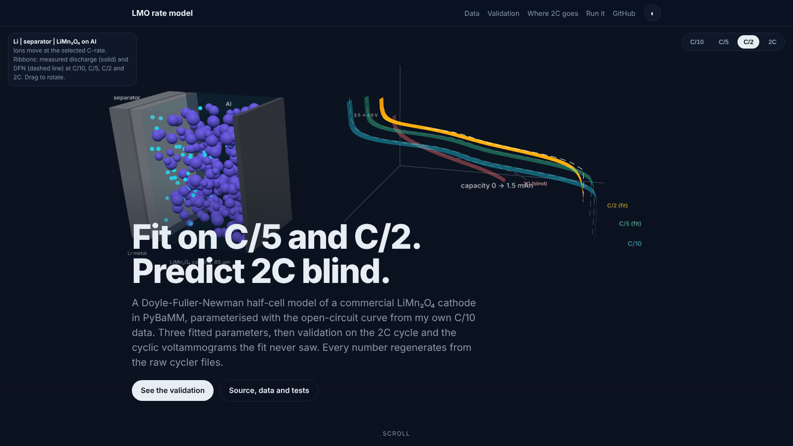
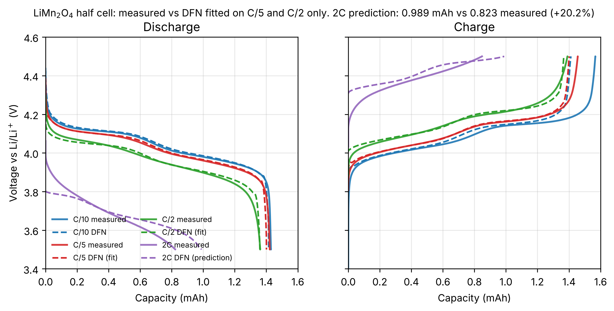
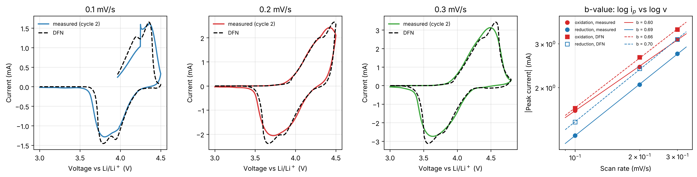
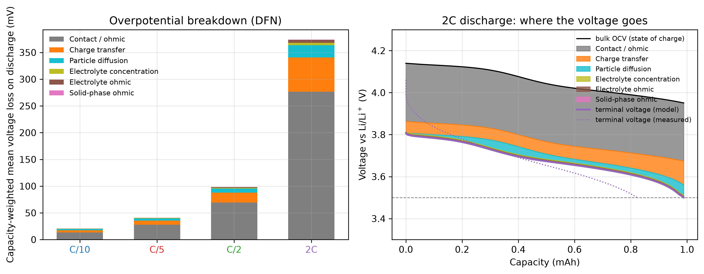

<p align="center"><a href="https://soham-cheme.github.io/LMO-Cathode-Rate-Model-PyBaMM/"></a></p>

<div align="center">

### [▶ View the live page](https://soham-cheme.github.io/LMO-Cathode-Rate-Model-PyBaMM/) · interactive cell, measured curves at four rates, where the 2C voltage goes

[](https://pybamm.org)
[](tests/)
[](docs/CLAIMS.md)

**Soham Kavathekar** · MS Chemical & Biomolecular Engineering, University of Pennsylvania
[stg3719@seas.upenn.edu](mailto:stg3719@seas.upenn.edu) · [linkedin.com/in/soham-kavathekar-cheme](https://www.linkedin.com/in/soham-kavathekar-cheme)

</div>

# LiMn2O4 half cell: a physics-based rate model fitted to my own data

A PyBaMM Doyle-Fuller-Newman (DFN) half-cell model of a commercial LiMn2O4 cathode against lithium metal,
parameterised with the open-circuit curve I measured at C/10, fitted to my C/5 and C/2 cycles only, and then
asked to predict the 2C cycle it had never seen and the cyclic voltammograms from a different technique.
All data were measured by me on one coin cell on a Bio-Logic VMP-300 (MSE 5550, University of Pennsylvania,
2026; see [`data/README.md`](data/README.md)). This file is generated by `scripts/write_readme.py` from
`results/*.json`; the full report with every model version is [`docs/REPORT.md`](docs/REPORT.md), and the
claim-by-claim audit is [`docs/CLAIMS.md`](docs/CLAIMS.md).

## Key results

- **Measurement:** galvanostatic C/10, C/5, C/2 and 2C plus CV at 0.1, 0.2 and 0.3 mV/s on one cell. At 2C the cell retains
  58 % of its C/10 discharge capacity and 53 % of its energy; round-trip energy efficiency is 95 % at C/5 and
  82 % at 2C (90 % at C/10, lowered by first-cycle parasitic oxidation near 4.5 V). Every measurement
  artefact in the raw files (current-range offset, contact disturbance, CV auto-ranging, protocol carry-over) is flagged in
  `data/README.md` and handled in the parser, not hidden.
- **Training (C/5, C/2):** voltage RMSE 26 mV with three fitted parameters (solid-diffusion time constant,
  reaction rate constant, contact resistance); C/10, not used in the fit, reproduced to 1.0 % in capacity.
- **Blind 2C prediction:** average discharge voltage within 17 mV of measured; discharge capacity
  0.988 mAh against 0.823 mAh (+20.1 %), i.e. the model predicts a 30 % capacity loss
  from C/10 to 2C where the cell lost 42 %.
- **Cyclic voltammetry, never used in the fit:** all six peak potentials at three scan rates within 80 mV
  (80 mV oxidation, 68 mV reduction); b-values 0.60 / 0.69 measured against 0.66 / 0.70 model.
- **Where the 2C voltage goes:** 74 % ohmic/contact, 17 % charge transfer, 6 % solid-state diffusion,
  3 % electrolyte (capacity-weighted mean loss 374 mV).
- **Model-free check from the 30 s rests:** the instantaneous resistance after charge is 72 Ω at C/10 to C/2
  (74 Ω at 2C, post-hoc) against the 97 Ω the curve-only fit needed: the fit assigns too much loss to
  resistance, and the log-time relaxation that follows is outside a one-particle-size, no-double-layer model.
- **Model versions, reported as they came out:** adding the rests to the fit (v2) makes things worse; adding double-layer
  capacitance (v2.1) cuts the rest misfit from 40 to 15 mV with R_contact 89 Ω but does not improve the blind 2C
  capacity; a tested electrolyte-oxidation side reaction (v3) reproduces the 91 % coulombic efficiency but not the after-charge rests.
  v1 stays the headline. Details, tables and figures for every version: [`docs/REPORT.md`](docs/REPORT.md).
- **Engineering:** 58 automated tests on the parser, OCV, model and every fit version; `python scripts/run_all.py` regenerates
  the processed data, results, figures and this README from the raw cycler files.



*Solid: measured. Dashed: DFN. C/5 and C/2 were used for fitting; C/10 is a low-rate check; 2C is a blind prediction.*

## Results

### Measured (representative cycle per rate; 2C uses cycle 2)

| Rate | I (mA) | Q discharge (mAh) | V̄ (V) | E (mWh) | Round-trip energy eff. (%) | Coulombic eff. (%) |
|---|---|---|---|---|---|---|
| C/10 | 0.140 | 1.430 | 4.036 | 5.77 | 90.1 | 91.2 |
| C/5 | 0.286 | 1.422 | 4.016 | 5.71 | 95.5 | 97.7 |
| C/2 | 0.717 | 1.361 | 3.960 | 5.39 | 93.2 | 98.0 |
| 2C | 2.864 | 0.823 | 3.696 | 3.04 | 82.0 | 97.0 |

### Blind validation (DFN, 10 mm disc)

| Rate | Role | Q meas / model (mAh) | ΔV̄ model − meas (mV) | V-Q RMSE (mV) |
|---|---|---|---|---|
| C/10 | low-rate check | 1.430 / 1.415 (-1.0 %) | +8 | 25 |
| C/5 | training | 1.422 / 1.401 (-1.5 %) | +7 | 26 |
| C/2 | training | 1.361 / 1.360 (-0.1 %) | +5 | 21 |
| 2C | blind prediction | 0.823 / 0.988 (+20.1 %) | -17 | 66 |

### Fitted effective parameters

| Model | Train RMSE (mV) | τ = R²/Ds (s) | Ds (m²/s) at R = 5 µm | k (m^2.5 mol^-0.5 s^-1) | R_contact (Ω) | 2C prediction (mAh) |
|---|---|---|---|---|---|---|
| SPMe | 26.2 | 2.19e+03 (2.12e+03 to 2.27e+03); LOO 901 to 2.34e+03 | 1.14e-14 (1.1e-14 to 1.18e-14); LOO 1.07e-14 to 2.78e-14 | 2.41e-11 (1.56e-11 to 3.71e-11); LOO 1.19e-11 to 1e-08 | 96.5 (88.2 to 106); LOO 80.6 to 122 | 0.989 (+20.2 %) |
| DFN | 26.2 | 2.19e+03 (2.11e+03 to 2.27e+03); LOO 902 to 2.34e+03 | 1.14e-14 (1.1e-14 to 1.18e-14); LOO 1.07e-14 to 2.77e-14 | 2.41e-11 (1.56e-11 to 3.71e-11); LOO 1.19e-11 to 9.83e-09 | 96.5 (88.2 to 106); LOO 80.5 to 122 | 0.988 (+20.1 %) |

Intervals in brackets are 95 % Jacobian intervals; "LOO" is the range over leave-one-training-step-out refits, the more honest
statement of uncertainty. k and R_contact are correlated at 0.94: the C/5 and C/2 curves split the ohmic and the
charge-transfer loss only weakly, which is why the 2C capacity is over-predicted.

### Cyclic voltammetry, simulated with the measured voltage programme (DFN)

| Scan rate | Ox. peak V (meas / model) | Ox. peak mA (meas / model) | Red. peak V (meas / model) | Red. peak mA (meas / model) | ΔEp mV (meas / model) |
|---|---|---|---|---|---|
| 0.1 mV/s | 4.35 / 4.35 | 1.62 / 1.65 | 3.81 / 3.79 | -1.28 / -1.45 | 548 / 566 |
| 0.2 mV/s | 4.42 / 4.48 | 2.42 / 2.65 | 3.72 / 3.66 | -2.06 / -2.38 | 693 / 813 |
| 0.3 mV/s | 4.49 / 4.57 | 3.12 / 3.42 | 3.64 / 3.57 | -2.73 / -3.12 | 856 / 1004 |



### Why 2C loses capacity (DFN)



The measured 2C curve falls faster than the model's. The fit on C/5 and C/2 cannot separate a large ohmic drop
from a transport limitation that grows with time, and it picked the ohmic explanation. The rests, the double-layer
and side-reaction versions, the disc-size sensitivity and the conclusions are in [`docs/REPORT.md`](docs/REPORT.md).

## How to run

```bash
git clone https://github.com/Soham-ChemE/LMO-Cathode-Rate-Model-PyBaMM.git
cd LMO-Cathode-Rate-Model-PyBaMM
python -m venv .venv && source .venv/bin/activate
pip install -r requirements.txt && pip install -e .
make test                          # 58 automated tests, under 10 s
python scripts/run_all.py --fast   # SPMe only, a few minutes
python scripts/run_all.py          # full DFN pipeline (the headline); regenerates results/, figures/, README.md, docs/REPORT.md
python docs/build_assets.py        # data and figures for the live page (docs/index.html opens from file://)
```

Method, assumptions and the repository layout are in [`docs/REPORT.md`](docs/REPORT.md).

## Citation

```bibtex
@misc{kavathekar2026lmo,
  author = {Kavathekar, Soham},
  title  = {LiMn2O4 half cell: a physics-based PyBaMM rate model fitted to measured galvanostatic data},
  year   = {2026},
  note   = {MSE 5550 project, University of Pennsylvania},
  url    = {https://github.com/Soham-ChemE/LMO-Cathode-Rate-Model-PyBaMM}
}
```
