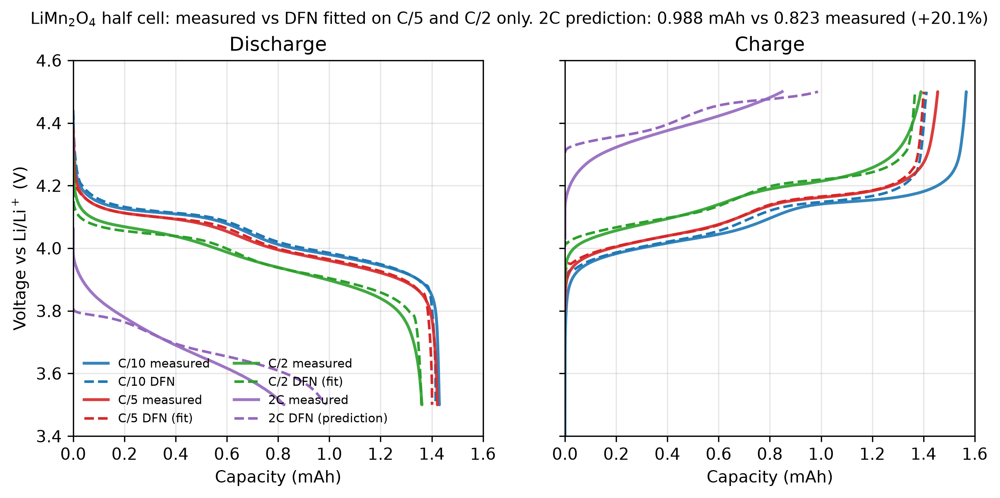
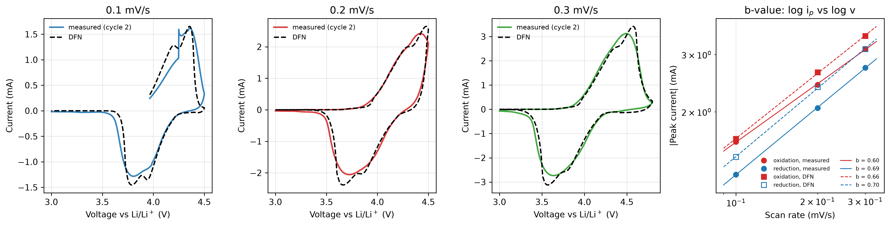
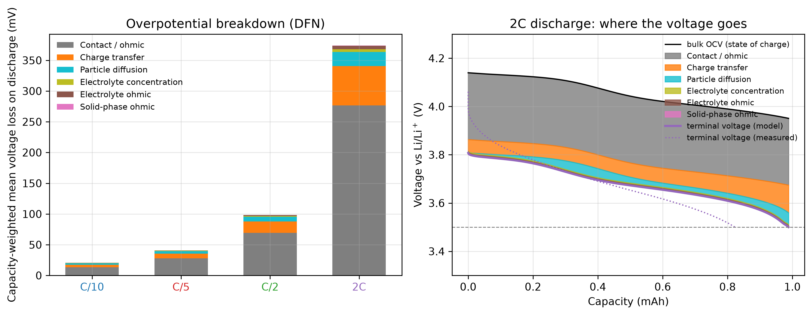

# LiMn2O4 half cell: a physics-based rate model fitted to my own data

A PyBaMM Doyle-Fuller-Newman (DFN) half-cell model of a commercial LiMn2O4 (LMO) cathode against lithium
metal, parameterised with the open-circuit curve I measured at C/10, fitted to my C/5 and C/2 cycles only,
and then asked to predict the 2C cycle it had never seen and the cyclic voltammograms from a different
technique. All data were measured by me on one coin cell (MSE 5550, University of Pennsylvania, 2026;
see `data/README.md`).

## Key results

- **Training (C/5, C/2):** voltage RMSE 26 mV with three fitted parameters; C/10, not used in the fit,
  reproduced to 1.0 % in capacity.
- **Blind 2C prediction:** average discharge voltage within 17 mV of measured; discharge capacity
  0.988 mAh against 0.823 mAh measured (+20.1 %). The model predicts a
  30 % capacity loss from C/10 to 2C; the cell lost 42 %. The SPMe gives 0.989 mAh (+20.2 %), so the two model fidelities agree on the 2C result to within 0.2 percentage points.
- **Cyclic voltammetry, a technique never used in the fit:** peak potentials at all three scan rates within
  80 mV (oxidation) and 68 mV (reduction); b-values 0.60 / 0.69 measured vs 0.66 / 0.70 model.
- **Diagnosis:** at 2C the model assigns 74 % of the voltage loss to ohmic/contact resistance; the shape of
  the measured 2C curve says the real cell has a transport loss that grows with time, which the fit could not
  separate from resistance (see "Why 2C loses capacity" and "Next step").



*Solid: measured. Dashed: DFN. C/5 and C/2 were used for fitting; C/10 is a low-rate check; 2C is a blind prediction.*

## Results

### Galvanostatic cycles (DFN, 10 mm disc)

| Rate | Cycle | Role | Q meas (mAh) | Q model (mAh) | Error (%) | V̄ meas (V) | V̄ model (V) | E meas (mWh) | E model (mWh) | V-Q RMSE (mV) |
|---|---|---|---|---|---|---|---|---|---|---|
| C/10 | 1 | low-rate check | 1.430 | 1.415 | -1.0 | 4.036 | 4.044 | 5.77 | 5.72 | 25 |
| C/5 | 1 | training | 1.422 | 1.401 | -1.5 | 4.016 | 4.023 | 5.71 | 5.64 | 26 |
| C/2 | 1 | training | 1.361 | 1.360 | -0.1 | 3.960 | 3.965 | 5.39 | 5.39 | 21 |
| 2C | 2 | blind prediction | 0.823 | 0.988 | +20.1 | 3.696 | 3.679 | 3.04 | 3.63 | 66 |

V-Q RMSE is computed on the measured capacity axis with the model held at the cut-off voltage beyond its own
capacity, so it penalises a capacity miss as well as a voltage miss. Charge-step metrics are in
`results/validation_dfn.json`; the C/10 and C/5 measured charges are longer than the model's because of
parasitic oxidation near 4.5 V (first-cycle coulombic efficiency at C/10 was 91 %), which the model does not include.

### Fitted effective parameters

| Model | Train RMSE (mV) | τ = R²/Ds (s) | Ds (m²/s) at R = 5 µm | k (m^2.5 mol^-0.5 s^-1) | R_contact (Ω) | 2C prediction (mAh) |
|---|---|---|---|---|---|---|
| SPMe | 26.2 | 2.19e+03 (2.12e+03 to 2.27e+03); LOO 901 to 2.34e+03 | 1.14e-14 (1.1e-14 to 1.18e-14); LOO 1.07e-14 to 2.78e-14 | 2.41e-11 (1.56e-11 to 3.71e-11); LOO 1.19e-11 to 1e-08 | 96.5 (88.2 to 106); LOO 80.6 to 122 | 0.989 (+20.2 %) |
| DFN | 26.2 | 2.19e+03 (2.11e+03 to 2.27e+03); LOO 902 to 2.34e+03 | 1.14e-14 (1.1e-14 to 1.18e-14); LOO 1.07e-14 to 2.77e-14 | 2.41e-11 (1.56e-11 to 3.71e-11); LOO 1.19e-11 to 9.83e-09 | 96.5 (88.2 to 106); LOO 80.5 to 122 | 0.988 (+20.1 %) |

Intervals in brackets are 95 % Jacobian intervals from the least-squares covariance; "LOO" is the range of
refits that each leave one of the four training steps out. The Jacobian intervals are far too narrow because
the 1200 residuals are strongly autocorrelated; the leave-one-out ranges are the more honest
statement of uncertainty. The log-parameters are correlated (k vs R_contact: 0.94), i.e. the data
split the ohmic and the charge-transfer loss only weakly. k enters j0 = k F sqrt(c_e c_s (c_max - c_s)).
Only τ = R²/Ds is identifiable; the 5 µm radius is a fixed choice.

### Cyclic voltammetry, simulated with the measured voltage programme (DFN)

| Scan rate | Ox. peak V (meas / model) | Ox. peak mA (meas / model) | Red. peak V (meas / model) | Red. peak mA (meas / model) | ΔEp mV (meas / model) |
|---|---|---|---|---|---|
| 0.1 mV/s | 4.35 / 4.35 | 1.62 / 1.65 | 3.81 / 3.79 | -1.28 / -1.45 | 548 / 566 |
| 0.2 mV/s | 4.42 / 4.48 | 2.42 / 2.65 | 3.72 / 3.66 | -2.06 / -2.38 | 693 / 813 |
| 0.3 mV/s | 4.49 / 4.57 | 3.12 / 3.42 | 3.64 / 3.57 | -2.73 / -3.12 | 856 / 1004 |

b-value (slope of log peak current vs log scan rate; 0.5 = semi-infinite diffusion, 1.0 = surface/capacitive):
measured 0.60 (oxidation) and 0.69 (reduction); model
0.66 and 0.70. Both sit between the two limits, as expected for a porous
electrode at scan rates where the sweep takes about as long as a 1C discharge. An apparent Randles-Sevcik
diffusivity from the measured peaks (planar-electrode formula, geometric 10 mm disc area, concentration of the
cycling lithium) is 1.8e-13 m²/s, 15.9 times the fitted solid-state Ds of
1.1e-14 m²/s. The two numbers are not expected to agree: Randles-Sevcik assumes a flat electrode, while
the real one is porous with a much larger internal area, so the apparent value is an upper bound.



### Why 2C loses capacity: overpotential breakdown (DFN)

Capacity-weighted mean voltage loss on discharge: C/10 20 mV, C/5 41 mV,
C/2 98 mV, 2C 374 mV. At 2C the model attributes 74 % of the loss to the
lumped contact/ohmic resistance, 17 % to charge transfer, 6 % to solid-state
diffusion in the particles and 3 % to the electrolyte. When the 2C
discharge hits 3.5 V the bulk open-circuit voltage of the particles is still 3.95 V, i.e. the model
has 0.15 mAh of lithium it could not deliver at that rate.



The measured 2C curve falls faster than the model's: the data show a steeper initial decline and lose
12 percentage points more capacity than predicted. The fit on C/5 and C/2 cannot separate a large
ohmic drop from a transport limitation that grows with time, and it picked the ohmic explanation. That is the
single biggest limitation of this work, and it is visible in the k / R_contact correlation above.

### Sensitivity to the unknown electrode area

| Model | Disc (mm) | Loading (mg/cm²) | Coating density (g/cm³) | ε_active | Porosity | Coating | Train RMSE (mV) | R_contact (Ω) | Ds (m²/s) | 2C prediction (mAh) |
|---|---|---|---|---|---|---|---|---|---|---|
| SPMe | 10 | 16.6 | 2.07 | 0.46 | 0.48 | plausible | 26.2 | 97 | 1.14e-14 | 0.989 (+20.2 %) |
| SPMe | 12 | 11.5 | 1.44 | 0.32 | 0.64 | light coating | 26.2 | 99 | 1.14e-14 | 0.989 (+20.2 %) |
| SPMe | 14 | 8.5 | 1.06 | 0.23 | 0.73 | implausibly porous | 26.2 | 101 | 1.14e-14 | 0.989 (+20.2 %) |
| SPMe | 16 | 6.5 | 0.81 | 0.18 | 0.80 | implausibly porous | 26.2 | 102 | 1.14e-14 | 0.989 (+20.2 %) |
| DFN | 10 | 16.6 | 2.07 | 0.46 | 0.48 | plausible | 26.2 | 97 | 1.14e-14 | 0.988 (+20.1 %) |
| DFN | 12 | 11.5 | 1.44 | 0.32 | 0.64 | light coating | 26.2 | 99 | 1.14e-14 | 0.988 (+20.1 %) |
| DFN | 14 | 8.5 | 1.06 | 0.23 | 0.73 | implausibly porous | 26.2 | 101 | 1.14e-14 | 0.989 (+20.2 %) |
| DFN | 16 | 6.5 | 0.81 | 0.18 | 0.80 | implausibly porous | 26.2 | 102 | 1.14e-14 | 0.989 (+20.2 %) |

The disc diameter is genuinely unknown: the EC-Lab `.mpr` settings block has electrode surface area and
characteristic mass at their 0.001 defaults (never entered); only the 1.434 mAh battery capacity was set. The
capacity therefore ties area to active volume fraction. Active mass = 1.434 mAh / 110 mAh/g = 13.0 mg,
active volume = 3.05e-3 cm³ at 4.28 g/cm³, so for the 85 µm coating ε_active = 0.358 / A[cm²]:
10 mm gives 0.46, 12 mm 0.32, 14 mm 0.23 and 16 mm 0.18. Binder and carbon (5.8 wt%) are taken at 1.8 g/cm³ and
the rest of the coating volume is pore. A calendered oxide cathode normally has a porosity of 0.25 to 0.40
(up to ~0.5 uncalendered) and an active volume fraction of 0.45 to 0.65. By that yardstick only the
10 mm disc gives a physically plausible coating; 12 mm would be an
unusually light coating and 14 to 16 mm imply porosities of 0.73 to 0.80, which no real electrode has. Either
the disc is small, or the 1.434 mAh (110 mAh/g) capacity under-states the active loading, so that the true
ε_active is higher than this derivation gives for any disc. The three parameters were re-fitted for every
diameter: the training RMSE, τ, k and the 2C prediction do not change to the precision shown
(2C spans 0.988 to 0.989 mAh), and only R_contact drifts by a few ohms as the electrolyte and solid
ohmic paths take up slack. The model is not electrolyte-limited with a lithium-metal counter electrode and this
electrolyte, so the unknown area does not affect the headline result. The headline uses the 10 mm disc, the only
diameter that gives a physically plausible coating.


## Next step

The weakest point is the 0.94 correlation between the rate constant and the contact resistance: C/5 and C/2 alone
cannot tell an instantaneous ohmic drop from a transport loss that builds up over time, so the fit chose the
ohmic explanation and over-predicts 2C capacity. Every galvanostatic step in this data ends with a 30 s rest; the
instantaneous voltage jump at the start of each rest is the ohmic part and the slow relaxation that follows is
the diffusion part. Adding those relaxations to the training set, still without touching 2C, is the direct way
to break that correlation.

## Method

1. **Parser** (`src/lmo/io.py`): reads the EC-Lab text exports, splits cycles and steps by the sign of the
   measured current, integrates the measured current for capacity. `tests/test_io.py` checks the capacities,
   mean voltages, energies and CV peaks against the values in `data/README.md` (within 1 %).
2. **Pseudo-OCV** (`src/lmo/ocv.py`): average of the C/10 cycle-2 charge and discharge on a normalised-capacity
   axis (each step normalised by its own capacity, which lines up both cut-offs and the plateau transition),
   Savitzky-Golay smoothed, forced monotonic, mapped to x in Li_xMn2O4 with x = 1 at 3.5 V and
   x = 0.264 at 4.5 V (theoretical capacity 1.932 mAh for the implied
   13.0 mg of LMO). dQ/dV at C/10 shows the two spinel plateaus at 3.99 and 4.11 V on discharge.
   The mean charge/discharge hysteresis at C/10 is 54 mV.
3. **Model** (`src/lmo/model.py`): PyBaMM `DFN` (and the other fidelity for comparison) with
   `working electrode = positive` and a contact resistance, starting from `Xu2019` for the lithium counter
   electrode, separator and electrolyte. Positive electrode: measured OCP, 85 µm, c_max = 23671 mol/m³
   from the LMO density, 10 mm disc (ε_active = 0.46, porosity 0.48),
   25 °C, Butler-Volmer kinetics, 5 µm particles.
4. **Fit** (`src/lmo/fit.py`): scipy `least_squares` in log10 space on the voltage-time curves of C/5 cycle 1
   and C/2 cycle 1 (charge and discharge, 300 points each), simulating the full charge/rest/discharge protocol
   from the measured rest voltage. Each training run is one PyBaMM simulation with the three parameters as
   inputs, so one residual evaluation costs a fraction of a second for SPMe.
5. **Blind validation** (`src/lmo/validate.py`): all four rates simulated with the fitted parameters from each
   run's own first cycle (2C is simulated through its cycle 1 so that cycle 2 carries the right history); CVs
   simulated in voltage-control mode by feeding the model the measured voltage programme.
6. **Diagnostics** (`src/lmo/diagnostics.py`): PyBaMM's voltage-component variables, checked to close to the
   terminal voltage to better than 1e-03 µV; CV b-values and Randles-Sevcik.
7. **Reproduce**: `pip install -r requirements.txt && pip install -e . && make all` regenerates
   `data/processed/`, `results/*.json`, `figures/*.png` and this README (`python scripts/write_readme.py`).
   `make test` runs the parser tests. `python scripts/run_all.py --fast` skips the DFN.

## Assumptions and limitations

- One cell, one cycle per rate, and the seven tests ran in sequence on that cell, so slow drift (Mn dissolution,
  electrolyte oxidation at 4.5 V) is folded into the fitted parameters.
- The electrode area was never entered in EC-Lab (surface area and characteristic mass are at the 0.001
  defaults in the `.mpr` settings), so it is derived from the capacity: ε_active = 0.358 / A[cm²].
  Only a 10 mm disc gives a conventional coating; the 12 to 16 mm discs imply light to implausibly porous
  coatings. The headline therefore uses 10 mm; the sensitivity table shows the prediction does not depend on
  this choice.
- The electrolyte is assumed to be 1 M LiPF6 in carbonates with the `Xu2019` / Valoen2005 transport
  properties, and the lithium-metal kinetics are Xu2019's.
- The fitted parameters are effective values: τ = R²/Ds at an assumed 5 µm radius, a rate constant that absorbs
  the unknown real surface area, and a contact resistance of about 97 Ω that lumps current-collector contact,
  separator and lithium-metal interphase resistance. The round-trip IR drop of that resistance at the C/10 current is 27 mV, about half of the
  54 mV mean charge/discharge hysteresis measured at C/10; the rest is kinetic and intrinsic hysteresis
  that the averaged pseudo-OCV absorbs.
- The pseudo-OCV is a C/10 average, not a true equilibrium curve, and is linearly extrapolated outside the
  3.5 to 4.5 V window, so the parts of the CVs below 3.5 V and above 4.5 V (the 0.3 mV/s sweep went to 4.8 V)
  are outside the model's validity.
- The model has no parasitic reactions, so measured charge capacities at low rate exceed the model's.
- Jacobian confidence intervals are lower bounds on the real uncertainty (autocorrelated residuals); the
  leave-one-step-out ranges are reported alongside.
- The 2C over-prediction is reported as measured. Nothing was tuned on the 2C or CV data.

## Repository layout

```
data/raw/            EC-Lab exports (never modified)      data/README.md   data notes and known quirks
data/processed/      pseudo-OCV, dQ/dV, model curves       src/lmo/         package (io, ocv, model, fit, validate, diagnostics, figures)
scripts/run_all.py   regenerates everything                scripts/write_readme.py renders this file from results/*.json
tests/test_io.py     parser tests vs the report values     notebooks/walkthrough.ipynb
results/*.json       every number quoted here              figures/*.png    300 dpi
results/resume_bullets.md
```
